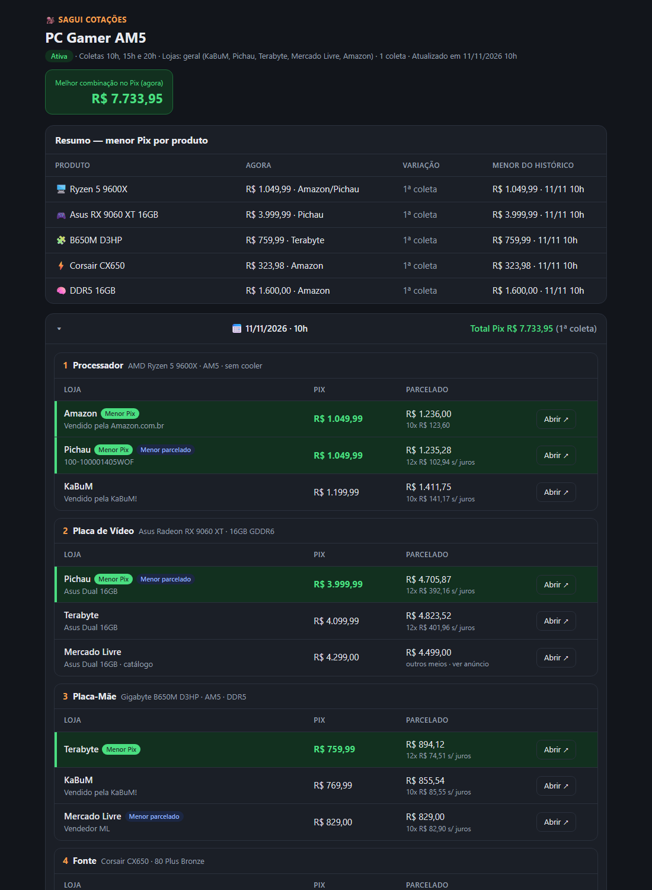

# 🐒 Sagui Cotações

**Skill de IA que cota preços para você em lojas brasileiras** — no Pix e no parcelado, só com estoque, sem sites
chineses — e guarda tudo num relatório HTML com histórico. Funciona no **Claude Code** e no **ChatGPT Codex**.



---

## O que ela faz

- 🛒 **Cota qualquer lista de produtos** — você descreve os itens com as características que não podem faltar
  (ex.: "placa de vídeo **16GB**", "memória **DDR5**").
- 🏬 **Lojas à sua escolha** ou modo *geral* (KaBuM, Pichau, Terabyte, Mercado Livre, Amazon, Magalu…).
  Nada de AliExpress, Shein, Temu ou "Compra Internacional".
- 💸 **Pix × parcelado** lado a lado, até 3 ofertas por item, cada uma com link direto para a compra.
- 🟢 **Menor Pix destacado em verde**, menor parcelado com etiqueta azul.
- 📈 **Histórico num único HTML**: a coleta mais recente no topo, variação (▲ subiu / ▼ caiu) e recorde de
  menor preço.
- ⏰ **Coletas automáticas** (ex.: 10h, 15h e 20h) e **alerta no WhatsApp** — *só no Claude Code com o app
  Claude*.

## Comandos

| Comando | O que faz |
|---|---|
| `/cotar` | Apresenta a Sagui, lista suas cotações e pergunta o que fazer |
| `/cotar nova` | Abre uma cotação: pede os itens em tópicos, lojas, horários e WhatsApp |
| `/cotar rodar <nome>` | Faz uma coleta agora |
| `/cotar editar <nome>` | Muda itens, lojas, horários ou WhatsApp |
| `/cotar concluir <nome>` | Encerra as coletas automáticas e fixa os melhores preços |
| `/cotar lista` | Mostra todas as cotações da pasta |

> No Codex, use `$cotar` no lugar de `/cotar` (ou peça: "use a skill cotar").

---

## Instalação

### 1. Baixe a skill

```bash
git clone https://github.com/guilhermehenrysilva/sagui-cotacoes.git
```

A skill é a pasta **`cotar/`** (`SKILL.md`, `lojas.md`, `modelo.html`).

### 2a. Claude Code

Copie a pasta `cotar/` para **um** destes lugares:

| Escopo | Caminho |
|---|---|
| Só no seu "ambiente" de cotações | `<sua-pasta>/.claude/skills/cotar/` |
| Em qualquer pasta (global) | `~/.claude/skills/cotar/` · Windows: `%USERPROFILE%\.claude\skills\cotar\` |

Abra uma nova sessão do Claude Code e digite `/cotar`.

### 2b. ChatGPT Codex

Copie a pasta `cotar/` para:

```
~/.codex/skills/cotar/        (Windows: %USERPROFILE%\.codex\skills\cotar\)
```

Reinicie o Codex e digite `$cotar`.
No Codex não há agendamento nem WhatsApp: as coletas são feitas quando você pedir (`$cotar rodar <nome>`).

### 3. Crie o "ambiente" (pasta das cotações)

A Sagui salva tudo **na pasta onde você abriu a IA**. Crie uma pasta só para isso e abra o Claude/Codex nela:

```
Documentos/
└── Cotações/            ← abra o Claude Code / Codex aqui
    └── cotacoes/        ← criada pela Sagui na primeira cotação
        ├── pc-gamer-am5.html
        └── home-office.html
```

Cada cotação é **um único arquivo `.html`** — relatório, configuração e histórico ficam todos dentro dele.
Abra no navegador para ver.

---

## Coletas automáticas e WhatsApp (Claude Code)

Para funcionar sozinho, mantenha:

1. **App Claude (desktop) aberto** — as tarefas agendadas só rodam com ele aberto (se estiver fechado, rodam ao abrir).
2. **Chrome aberto com a extensão Claude in Chrome** — é por ele que a Sagui navega nas lojas.
3. **WhatsApp Web conectado nesse Chrome** — o resumo é enviado **apenas** para a sua conversa *"Eu (você)"*.

Se algo disso faltar, a Sagui faz só a cotação e salva o HTML na pasta.

Exemplo de alerta:

```
🐒 A Sagui Cotações encontrou novos preços!
📋 PC Gamer AM5 · 11/11 15h

🖥️ CPU Ryzen 5 9600X: R$ 1.049,99 · Pichau (▼ -R$ 20,00)
🎮 GPU RX 9060 XT 16GB: R$ 3.999,99 · Pichau (= sem mudança)
🧠 RAM DDR5 16GB: R$ 1.600,00 · Amazon (▼ -R$ 50,00)

💰 Total Pix: R$ 7.733,95 (▼ -R$ 70,00)
📁 cotacoes/pc-gamer-am5.html
```

---

## Estrutura do repositório

```
cotar/
├── SKILL.md       ← regras e fluxos da Sagui (comandos, coleta, WhatsApp, agendamento)
├── lojas.md       ← como coletar em cada loja
└── modelo.html    ← modelo visual do relatório
exemplos/
└── pc-gamer-am5.html   ← relatório real gerado pela Sagui
```

## Avisos

- Preços e estoque mudam a todo momento — confirme na loja antes de comprar.
- A Sagui só lê páginas públicas das lojas; ela não compra nada nem faz login por você.
- Lojas mudam o layout dos sites; se alguma parar de funcionar, ajuste `cotar/lojas.md` (PRs são bem-vindos!).

## Licença

[MIT](LICENSE) — use, modifique e compartilhe à vontade.
